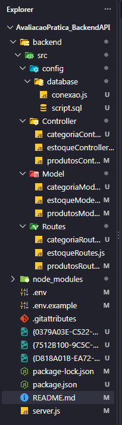
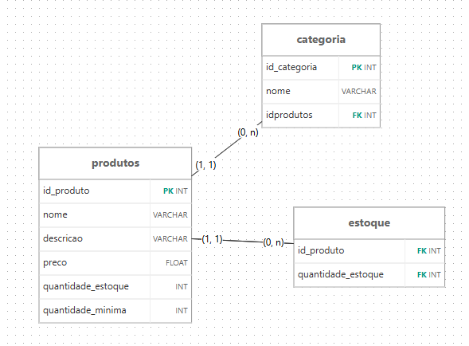
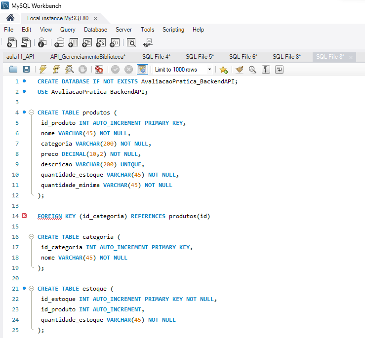
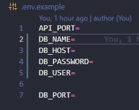
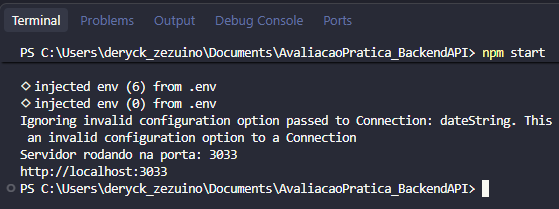
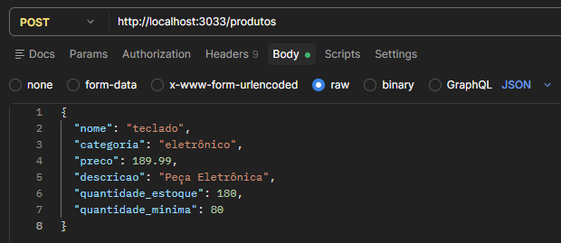

# Orientações necessárias para testar as funcionalidades implementadas no backend (API) de Avaliação Prática

## Tecnologias Utilizadas :
- Node.js
- Express
- MySQL

## Bibliotecas Utilizadas :
- dotenv
- mysql2

## Estrutura MVC (organização de pastas e arquivo de uma API), Exemplo de como fica a estrutura organizada em MVC :



## Tabelas de Relacionamento DER :


## Exemplo de como fica o script no mysql workbench :



## Passo a passo de como executar :
1. Execute o `database/script.sql` no MySQL Worckbench;

2. Abra um terminal na pasta do projeto e execute o comando :
```powershell
npm init -y

```
3. E depois execute :
```powershell
npm install node nodemon express dotenv mysql2
```
4. Copie `.env.example` para `.env` e modifique usuário, senha e os demais dados correspondentes; Exemplo de como fica o arquivo .env.example :



5. Execute `npm run dev` para desenvolvimento ou `npm start` para execução normal; Exemplo no terminal de como fica após a execução do comando :



6. No terminal aparecerá : A API ficará disponível em `http://localhost:3033`.

## Rotas :
Base : `/produtos`

| Método | Rota | Descrição |
|------- |----- |---------- |
| GET | `/produtos` | Lista produtos |
| GET | `/produtos/:id` | Consulta um produto |
| POST | `/produtos` | Cadastra um produto |
| PUT | `/produtos/:id` | Atualização completa |
| DELETE | `/produtos/:id` | Exclui um produto |

### Exemplo de body(produtos) para POST/PUT
```json
{
  "nome": "teclado",
  "categoria": "eletrônico",
  "preco": 189.99,
  "descricao": "Peça Eletrônica",
  "quantidade_estoque": 180,
  "quantidade_minima": 80
}
```
### Exemplo de como fica a rota post (produtos/:id) no postman :


